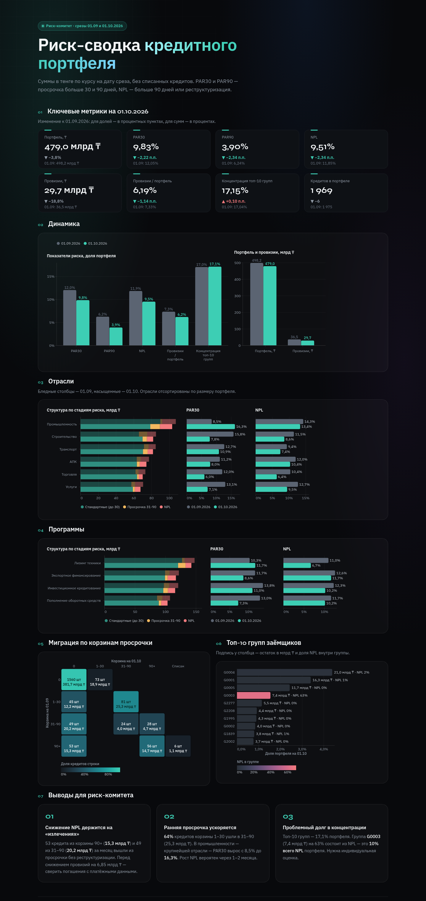
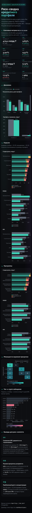

# Риск-сводка кредитного портфеля

Сводка по синтетическому кредитному портфелю на срезах 01.09.2026 и 01.10.2026. Стек: PostgreSQL 16, семантическая модель в YAML, дашборд на Vega-Lite.



<details>
<summary>Мобильная версия (390 px)</summary>



</details>

## Как запустить

Нужны Docker, `make`, Python 3 (только стандартная библиотека) и Google Chrome (только для скриншота).

```bash
make all      # поднять Postgres, загрузить CSV, создать вьюхи, проверить инварианты, выгрузить JSON, сверить с Python
make serve    # дашборд на http://localhost:8000
make screenshot   # при запущенном make serve — обновить docs/dashboard.png
make screenshot-mobile   # то же для мобильной версии — docs/dashboard-mobile.png
make down     # остановить Postgres
```

Секции дашборда проявляются при прокрутке, а цифры и столбцы растут от нуля. Каждая спека содержит параметр `grow` (по умолчанию 1), страница анимирует его от 0 до 1 через API Vega. Без JS спеки рисуются статично. `?static=1` в адресе и системная настройка «уменьшить движение» отключают анимацию; скриншот снимается именно так.

Postgres слушает `localhost:5433`, пользователь, пароль и база — `risk`. Любой шаг можно запускать повторно: `make load views` перезаливает данные и пересоздаёт вьюхи без ошибок.

## Структура

| Путь | Что внутри |
|---|---|
| [data/](data/) | исходные CSV: `portfolio.csv` (два среза портфеля) и `fx.csv` (курсы к тенге) |
| [docker-compose.yml](docker-compose.yml) | PostgreSQL 16 с примонтированными `data/` и `sql/` |
| [Makefile](Makefile) | все шаги: запуск, загрузка, вьюхи, проверки, выгрузка, сверка, скриншот |
| [sql/01_raw.sql](sql/01_raw.sql) | схема `raw`: таблицы и загрузка CSV как есть (TRUNCATE + COPY в одной транзакции) |
| [sql/02_reporting.sql](sql/02_reporting.sql) | схема `reporting`: очищенная витрина и метрики (только `CREATE OR REPLACE VIEW`) |
| [sql/03_checks.sql](sql/03_checks.sql) | инварианты витрины, при нарушении — ошибка |
| [model/loan_portfolio.yaml](model/loan_portfolio.yaml) | семантическая модель поверх `reporting.v_loan_mart` |
| [dashboard/specs/](dashboard/specs/) | спеки Vega-Lite (JSON) |
| [dashboard/index.html](dashboard/index.html) | статичная страница, рисует спеки через vega-embed |
| [dashboard/data/](dashboard/data/) | данные дашборда — выгрузка вьюх `reporting` (`make export`) |
| [scripts/verify.py](scripts/verify.py) | независимый пересчёт метрик из CSV и сверка с Postgres |
| [docs/dashboard.png](docs/dashboard.png), [docs/dashboard-mobile.png](docs/dashboard-mobile.png) | скриншоты дашборда: десктоп и телефон |

Вьюхи `reporting`:

- `v_fx_on_report_date` — курс к тенге на дату среза (KZT = 1);
- `v_loan_status` — все кредиты без дублей, с признаками риска, включая списанные;
- `v_loan_mart` — **очищенная витрина**: портфель без списанных, суммы в тенге, провизии;
- `v_metrics_by_date`, `v_metrics_long` — метрики на каждую дату;
- `v_metrics_change` — метрики на 01.10 с изменением к 01.09;
- `v_breakdown`, `v_breakdown_stage` — разрезы по отрасли и программе;
- `v_top_groups`, `v_dpd_migration` — концентрация и миграция по корзинам просрочки;
- `v_data_quality` — что найдено в сырых данных и как обработано.

## Определения и принятые решения

- **Портфель** — сумма `principal_outstanding × курс на дату среза`, без списанных кредитов.
- **PAR30 / PAR90** — доля портфеля с просрочкой строго больше 30 / 90 дней. Кредиты ровно с 30 и 90 днями (2 и 4 шт.) в PAR30 / PAR90 не входят.
- **NPL** — просрочка > 90 дней **или** реструктуризация.
- **Провизии** — 1% при просрочке до 30 дней включительно, 10% при 31–90, 50% для NPL. NPL имеет приоритет: реструктуризированный кредит без просрочки резервируется на 50%.
- **Концентрация** — доля десяти крупнейших групп `group_id` в портфеле на каждую дату.

Что найдено в данных и как обработано (`reporting.v_data_quality`):

| Находка | Сколько | Решение |
|---|---|---|
| Полные дубли строк | 30 на каждую дату (4060 строк → 4000) | удалены |
| Кредит списан на 01.09, а на 01.10 `written_off = 0` | 23 | **списание считается необратимым**, кредиты исключены и на 01.10 |
| Курс на дату среза | есть на обе даты | берётся курс ровно на дату среза, не на конец предыдущего месяца (курс 31.08 = 473,47, 01.09 = 478,35) |
| Срок погашения прошёл, просрочки нет | 355 / 375 | оставлены как есть, отмечены флагом `is_past_maturity` |

Если брать флаг списания буквально, на 01.10 портфель был бы 484,7 млрд ₸, NPL — 10,01%, PAR90 — 4,46%, провизии — 31,2 млрд ₸ (`make verify` печатает этот сценарий).

## Итоговые цифры

| Метрика | 01.09.2026 | 01.10.2026 | Изменение |
|---|---:|---:|---:|
| Портфель | 498,15 млрд ₸ | 479,00 млрд ₸ | −19,15 млрд ₸ (−3,8%) |
| PAR30 | 12,05% | 9,83% | −2,22 п.п. |
| PAR90 | 6,24% | 3,90% | −2,34 п.п. |
| NPL | 11,85% | 9,51% | −2,34 п.п. |
| Провизии | 36,51 млрд ₸ | 29,66 млрд ₸ | −6,85 млрд ₸ (−18,8%) |
| Провизии / портфель | 7,33% | 6,19% | −1,14 п.п. |
| Концентрация топ-10 групп | 17,04% | 17,15% | +0,10 п.п. |
| Кредитов в портфеле | 1 975 | 1 969 | −6 |

Портфель снизился на 19,15 млрд ₸: −18,51 млрд — погашения, −1,06 млрд — 6 новых списаний, +0,42 млрд — переоценка USD-кредитов (USD ≈ 11% портфеля, курс 478,35 → 482,10).

## Три вывода для риск-комитета

1. **Снижение NPL на 2,3 п.п. держится на «излечениях», которые нужно подтвердить.** 53 кредита из корзины 90+ (15,3 млрд ₸) и 49 из 31–90 (20,2 млрд ₸) за месяц полностью вышли из просрочки. Реструктуризаций среди них нет, списаний — всего 6 кредитов на 1,1 млрд ₸. Кроме того, у 23 ранее списанных кредитов сброшен флаг списания. Прежде чем снижать провизии на 6,85 млрд ₸, стоит сверить погашения с платёжными данными.
2. **Ранняя просрочка ускоряется — рост NPL вероятен через 1–2 месяца.** 81 из 126 кредитов (64%) с просрочкой 1–30 дней ушли в 31–90 (25,3 млрд ₸), ещё 73 кредита (18,9 млрд ₸) перешли из корзины 0 в 1–30. Объём в стадии 31–90 почти не снизился: 28,9 → 28,3 млрд ₸. Самый заметный сдвиг — в промышленности, крупнейшей отрасли (21,6% портфеля): PAR30 вырос с 8,5% до 16,3%. Из программ PAR30 вырос только в лизинге техники: 10,3% → 11,7%.
3. **Концентрация стабильна, но в ней сидит крупный проблемный долг.** Топ-10 групп — 17,1% портфеля. Группа G0003 (4-я по размеру, 7,4 млрд ₸) на 63% состоит из NPL: это 4,66 млрд ₸, или 10% всего NPL портфеля. Нужна индивидуальная оценка G0003 и проверка лимитов на крупнейшую группу G0004 (4,4% портфеля).

## Как проверялись цифры

- **Независимый пересчёт.** [scripts/verify.py](scripts/verify.py) считает все метрики напрямую из CSV на Python (Decimal, без SQL и pandas) и сверяет их с выгрузкой из Postgres. Все 16 значений (8 метрик × 2 даты) совпадают до 1e-9.
- **Инварианты в SQL** ([sql/03_checks.sql](sql/03_checks.sql)): ключ `(report_date, loan_id)` в витрине уникален; курс найден для каждой валюты и даты; ни один несписанный кредит не потерян; сумма по отраслям, программам и стадиям риска равна портфелю; PAR90 ≤ PAR30, PAR90 ≤ NPL ≤ портфель.
- **Профилирование сырья до SQL**: дубли, пропуски, отрицательные значения, валюты, смена атрибутов кредита между срезами, даты. Так нашлись дубли и отмена списаний.
- **Ручные сверки**: границы корзин (ровно 30 и 90 дней), курс именно на дату среза, разложение изменения портфеля на погашения, списания и курс сходится до копейки.
- **Идемпотентность**: `make load views check` запускался повторно — без ошибок, число строк в `raw` не меняется.
